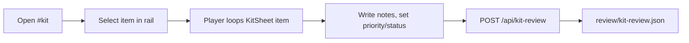
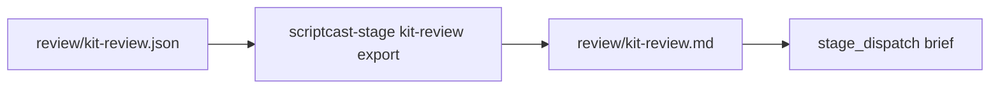
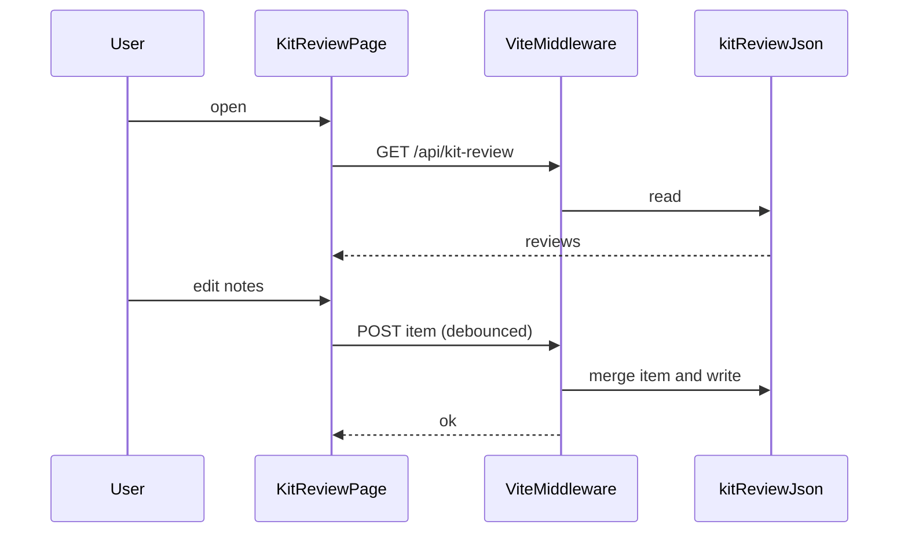
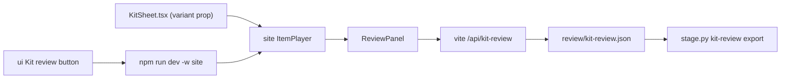

# Kit Review page

## 1. Epic Brief

**Summary.** Add an interactive Kit Review page to ScriptCast. It lists every stage-kit item (34 today: 15 components, 12 primitives, 7 motion components). For each item it plays the item's animation live and lets you scrub it, step through it, change its variant and slow it down. Beside the player you write notes and set a priority and a status. The page saves those reviews to a file in the repository. Workers can read that file, so a curated review turns directly into dispatch briefs. The native UI gets a button that opens the page.

**Context and problem.** Kit review currently goes through static sheets: a zip of PNG and PDF files (`video/scripts/render-kit-sheets.mjs`). They can't show motion except as a 5-step strip. Notes live in chat and priorities in your head, so nothing is recorded where a worker can act on it. The person affected is the author curating the kit before scenes get redone. The page lives in the ScriptCast web app (`site/`), with an entry point in the native app (`ui/`). After this change, kit decisions are a tracked file (`review/kit-review.json`) with history in git, instead of chat messages.

## 2. Core Flows

### Flow A: review an item
Trigger: you open `#kit` in the site, or press "Kit review" in the native UI.
1. The left rail lists all items, grouped (Components, Primitives, Motion). Each shows a priority badge and a status dot.
2. Selecting an item loads it into a Remotion Player that loops its animation. The controls are play/pause, a scrub bar, frame step, speed (0.25x/0.5x/1x) and a variant picker for motion items.
3. The right panel shows the item's source path, a notes box (Markdown, autosaved), priority (P0–P3 or none), status (Unreviewed, Keep, Change, Cut) and optional tags.
4. Edits save 500 ms after typing stops. A "saved" tick confirms each save.



Artifact output: `review/kit-review.json`, shaped as `{version:1, items:{<id>:{priority,status,notes,tags,updated}}}`.

### Flow B: turn reviews into work
Trigger: you finish a review pass.
1. Run `scriptcast-stage kit-review export`. It writes `review/kit-review.md`, listing items with status Change or Cut, sorted by priority, with your notes verbatim.
2. That file is the input for the next worker brief (`stage_dispatch`).



### Flow C: open from the native app
Trigger: the "Kit review" button in the Stage column (`ui/src/stage_view.rs`).
1. If the site dev server isn't running, the button starts it (`npm run dev -w site`) and opens `http://localhost:<port>/#kit` in the browser.

## 3. Tech Plan

**Architectural approach.** Reuse what already exists. The site already depends on `@remotion/player` and React 19 (`site/package.json`), so the page renders the same `KitSheet` composition used for the stills, from `video/src/stage/kit/KitSheet.tsx`. That means one definition of each specimen for both the sheets and the page. Saving uses a small Vite dev-server middleware, so no new server process is needed.

| Decision | Choice | Why |
|---|---|---|
| Where the page lives | `site/` as route `#kit` | It already has the Player and a hash router (`site/src/main.tsx:11-32`) |
| How to render items | `KitSheet` from `video/` through the Player, with `item` and `variant` props | One source of truth with the PNG/PDF sheets |
| Storage | `review/kit-review.json` in the repository | It's diffable, has git history, and workers can read it |
| Save path | Vite `configureServer` middleware: `GET`/`POST /api/kit-review` | No extra service; it exists only in dev, which is the only place review happens |
| Native integration | A button that launches the server and opens the browser | egui can't host the Remotion Player; embedding a webview is out of scope |
| Variant picking | A `variant` prop added to `KitSheet` motion items | You can compare opus, argon, astra and kimi in place |

**Failure modes.**

| Failure | Effect | Handling |
|---|---|---|
| Save fails (server stopped) | Notes could be lost | Keep unsaved edits in localStorage and show an "unsaved" badge; retry on the next edit |
| JSON is corrupt or hand-edited badly | The page can't load reviews | Validate on read; on error, show the error and refuse to overwrite |
| A kit item is added or renamed | The review loses its key | Key by item id. Reviews for unknown ids are shown under "Orphaned", never deleted |
| Two tabs edit at once | The last write wins | Per-item `updated` timestamps; the server merges per item instead of replacing the whole file |
| The video bundle doesn't import cleanly into Vite (e.g. the `@stage` alias or `staticFile` assets) | The page won't build | Add the aliases in `site/vite.config.ts`; `publicDir` already points at `video/public` |

**Data model.**
```ts
type KitReview = {version: 1; items: Record<string, {
  priority: 'P0'|'P1'|'P2'|'P3'|null;
  status: 'unreviewed'|'keep'|'change'|'cut';
  notes: string; tags: string[]; updated: string /* ISO */;
}>};
```

**Component architecture.** `KitReviewPage` (layout) contains `ItemRail` (list, filters, sorting), `ItemPlayer` (Player plus controls) and `ReviewPanel` (notes, priority, status, tags). The hook `useKitReview()` handles load, debounced save and the localStorage fallback.



## 4. Implementation Plan

Preamble: the build goes to one worker (Terra) in a scriptCast worktree. Claude reviews, runs the page and merges. No existing kit component changes, except that `KitSheet` gains a `variant` prop.

**Observations.**
- `site/src/main.tsx:11-32`: the hash router has two routes (`#`, `#player`); a third slots in the same way.
- `site/vite.config.ts`: `publicDir: '../video/public'` already serves the kit's sound and asset files.
- `video/src/stage/kit/KitSheet.tsx:31` exports `KitSheetIndex` (id, source, motion), and `:93` exports `KitSheet({item})`.
- `ui/src/stage_view.rs:308` defines `StageAction`; a new action variant carries the button press.
- `docs/stage-review.md` documents the JSONL rejection convention under `review/`. Kit review follows it with a sibling file.

**Steps.**
1. `video/src/stage/kit/KitSheet.tsx`: add an optional `variant` prop and pass it to motion items. Default output stays unchanged, which the existing sheet render checks.
2. `site/vite.config.ts`: resolve aliases for `@stage` and the video sources, and add the `kit-review` middleware: GET returns the file; POST validates one item and merges it by id, writing atomically through a temp file and rename.
3. `site/src/kit/`: add `KitReviewPage.tsx`, `ItemRail.tsx`, `ItemPlayer.tsx`, `ReviewPanel.tsx` and `useKitReview.ts`.
4. `site/src/main.tsx`: add the `#kit` route and nav link.
5. `scriptcast/tools/stage.py`: add a `kit-review export` subcommand (JSON to Markdown, filtered and sorted).
6. `ui/src/stage_view.rs`: add a "Kit review" button and a `StageAction::OpenKitReview` handler that starts the server if needed and opens the URL.
7. Docs: add a "Kit review" section to `docs/stage-kit.md`.

**Acceptance.**
- `npm run build -w site` passes.
- The page loads all 34 items, plays each one, and a note survives a reload.
- `review/kit-review.json` changes only for the edited item.
- `scriptcast-stage kit-review export` writes a sorted Markdown file.
- `cargo test` passes in `ui/`.



| File | Change |
|---|---|
| `video/src/stage/kit/KitSheet.tsx` | `variant` prop |
| `site/vite.config.ts` | aliases and save middleware |
| `site/src/main.tsx` | `#kit` route |
| `site/src/kit/*` (new) | page, rail, player, panel, hook |
| `scriptcast/tools/stage.py` | `kit-review export` |
| `ui/src/stage_view.rs` | open button |
| `docs/stage-kit.md` | docs |
| `review/kit-review.json` (new, created on first save) | data |

## 5. Plan Audit

To be filled in after the build: one row per step, with outcome and deviation.

| Step | Outcome | Deviation |
|---|---|---|
| 1–7 | pending | |
