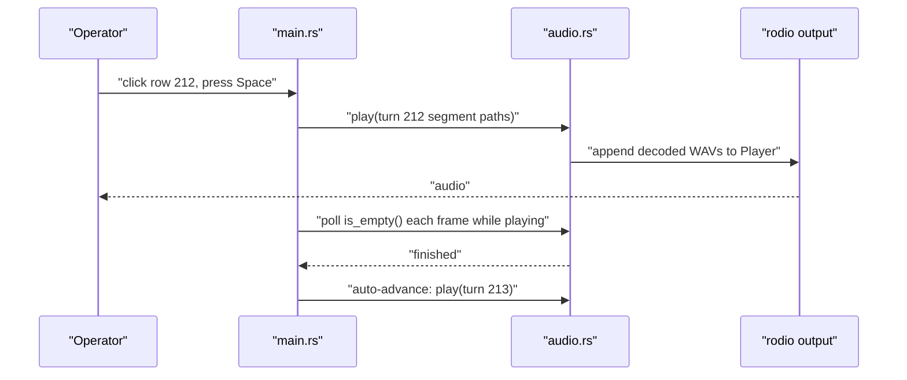
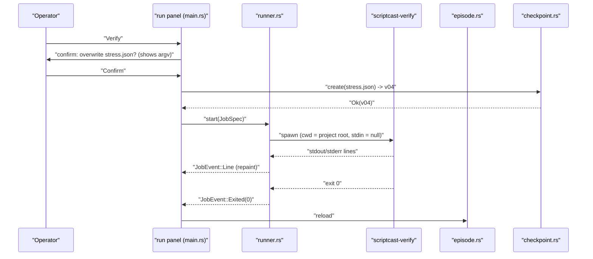
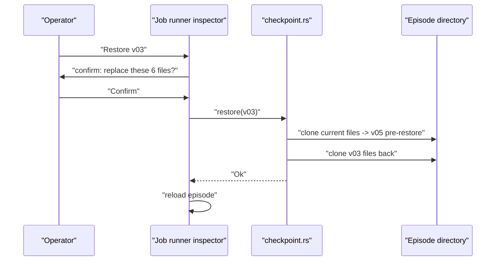
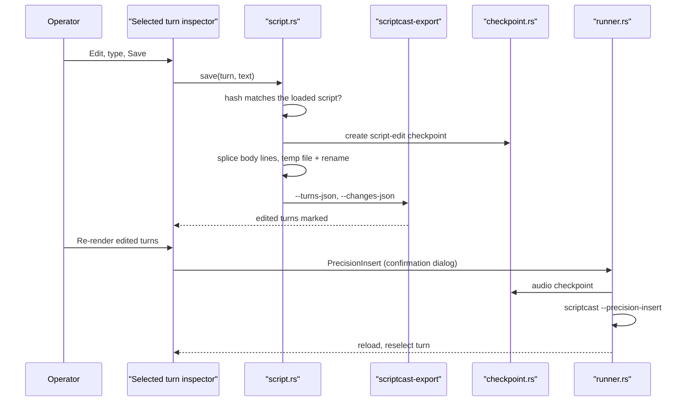
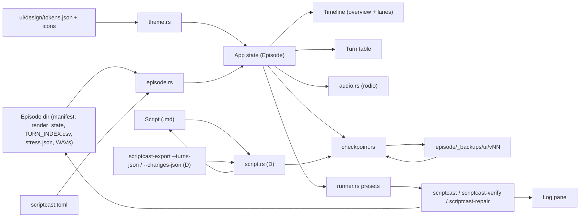

# Plan: Native UI — a Lightweight egui Window for scriptCast

Host project: `file:Dev/Tools/scriptCast/` (Python package `scriptcast`, branch `dev`), new crate `file:Dev/Tools/scriptCast/ui/` (Rust, eframe/egui, binary `scriptcast-ui`)
Spec: See [ui/SPEC.md](../../ui/SPEC.md) for the product-level spec.
Design: See [ui/design/DESIGN.md](../../ui/design/DESIGN.md) — offline snapshot of the Figma design (screens, tokens, icons). The visual source of truth; never call Figma from a loop.
Tech Plan: See [Tech Plan](tech-plan.md) for full architectural detail.
Loops: See [loop.md](loop.md) for implementer/verifier prompts.

---

## Section 1: Epic Brief

### Summary

scriptCast renders a markdown podcast script into per-turn speech, verifies it with Whisper, repairs failed turns, and exports DAW sessions — all as a set of Python CLIs (`file:Dev/Tools/scriptCast/pyproject.toml:42-54`). Today the only way to see a rendered episode is to read `episode_manifest.json`, `TURN_INDEX.csv` and `stress.json` by hand, open the Ableton set, or scroll terminal output from `scriptcast-verify`. Finding turn 212, hearing it, and re-rendering it is a multi-tool round trip. This epic adds a native desktop window, written in Rust with egui, that opens an episode output directory instantly, shows every turn on a speaker-coloured timeline and in a searchable table, plays any turn's processed WAV with one key, overlays the verifier's results per turn, and launches the existing CLIs (detect changes, precision insert, regenerate selected turns, verify, repair) with their output streamed live into the window. The UI is a thin front-end: it reads the files the Python tools write and shells out to the Python tools; it never reimplements synthesis, verification or export, and the only files it ever writes itself are reversible checkpoints: before any job that replaces audio or verification output, it clones the files that job can change into the episode's `_backups/ui/` folder, and it can restore them later. The interface is set in OpenDyslexic. Delivery is three phases: Phase A is a read-only episode browser (loader, header, timeline, virtualised table, error states); Phase B adds per-turn playback with keyboard navigation; Phase C adds the job runner with safe command presets, checkpoints and restore, and the verify-results overlay. Phase D (operator request 2026-10-03) adds inline editing of a turn's words in the Selected turn panel, saved into the script, and a confirmed re-render of the edited turns through Phase C's Precision insert.

### Context & Problem

**Who's affected**
- The operator producing episodes (currently the ATO podcast in `file:Documents/Theory/TheOriginalPower/`): every review pass means locating a turn by index in `TURN_INDEX.csv`, finding its WAV under `Samples/Processed/<speaker>/`, and playing it in Finder or Ableton.
- The verify/repair loop: `scriptcast-verify` prints flagged turns to the terminal (`file:Dev/Tools/scriptCast/scriptcast/tools/verify_render.py:275-303`) and optionally writes JSON; nothing shows those results against the timeline.
- Re-rendering: the right flags (`--precision-insert`, `--regenerate-turns`, never a bare re-render that hits the interactive prompt) are easy to get wrong from memory.

**Where in the product**
- Episode output directory written by the renderer: `episode_manifest.json` (`file:Dev/Tools/scriptCast/scriptcast/manifest.py:94-189`), `render_state.json` (`file:Dev/Tools/scriptCast/scriptcast/render_state.py:165`), `TURN_INDEX.csv` (`file:Dev/Tools/scriptCast/scriptcast/tools/turn_index.py:37`), `stress.json` (verify `--json-out`, `file:Dev/Tools/scriptCast/scriptcast/tools/verify_render.py:185`), processed WAVs under `Samples/Processed/<speaker>/`.
- Project configuration: `scriptcast.toml` at the project root (`file:Dev/Tools/scriptCast/scriptcast/project.py:1-34`).
- CLIs the UI launches: `scriptcast` (`file:Dev/Tools/scriptCast/scriptcast/__main__.py:867`), `scriptcast-verify`, `scriptcast-repair` (`file:Dev/Tools/scriptCast/scriptcast/tools/repair_render.py:89-107`).

**What changes**
- Phase A adds `ui/` with a theme built from the design tokens, a manifest/render-state/CSV/stress loader, project-root discovery, and a read-only window matching design screens 01–02: empty workspace with recent episodes, header, overview strip plus speaker-lane timeline, virtualised turn table with speaker filter, search and verification column, and the Empty, Loading and Error workspace states.
- Phase B adds `audio.rs`: Space plays or pauses the selected turn's WAV through rodio, Esc stops, Up and Down move the selection, auto-advance is optional, a seek track shows progress, the output device is selectable, and a Selected turn inspector appears (screen 03).
- Phase C adds `runner.rs` and `checkpoint.rs` with the Verification and Job runner inspectors and the confirmation dialog (screens 04–06): fixed command presets built from the episode's own metadata, a live log, Cancel, confirmation showing the exact command for anything that synthesizes or overwrites, a checkpoint saved before each such job with a Checkpoints list and Restore, automatic reload after a job, and failed-turn markers from `stress.json`.
- Phase D adds `script.rs` and an edit mode in the Selected turn inspector: the turn's full text, an editor for its body, Save into the script (hash-checked, atomic, with a checkpoint of the script first), Edited markers on the table and timeline, and "Re-render edited turns", which runs Phase C's Precision insert through the confirmation dialog.
- No Python file changes except two operator-approved, read-only additions to `scriptcast-export`: `--fcpxml` (B2, approved 2026-10-03) and `--turns-json` / `--changes-json` (D, pending approval).

---

## Section 2: Core Flows

## Flow 0: Real-time Review and Agent-Assisted Editing (Future Phase)

**Description:** The operator listens to an episode while making rapid, targeted edits with help from a preferred agent. Playback, manual editing, and agent work remain available in one continuous workspace.

**Trigger:** The operator opens an episode, starts playback, and selects a favorite agent from the agent selector.

**Steps:**

1. The UI opens the episode with a synchronized waveform/timeline, transcript, playback controls, and an agent conversation panel. The currently playing transcript sentence and waveform range remain highlighted.
2. While listening, the operator selects a word, sentence, or time range and makes a quick edit: remove filler words or pauses, rewrite a sentence, adjust tone or pacing, or move a segment. The operator can preview the change without losing the current playback position.
3. The operator sends a targeted instruction to the selected agent, such as: "Make this intro 20 seconds shorter, keep the main idea, and make the tone more energetic." The agent receives the selected range and relevant episode context while playback and independent manual edits continue.
4. The agent returns a proposed edit with a short explanation, affected range, before/after transcript, and `Preview`, `Apply`, and `Reject` actions. Proposed edits are never applied silently.
5. `Preview` temporarily plays the proposed version while leaving the rest of the episode unchanged. The operator can switch between Original, Proposed, and Current working versions, then accept, reject, or refine the proposal.
6. The operator can queue independent requests in parallel, such as removing filler words across the episode, tightening the opening, improving a transition, or normalizing a guest's volume. Each request shows `Analyzing`, `Ready for review`, `Applied`, `Needs attention`, or `Failed`.
7. If two requests affect overlapping audio, the UI marks the conflict and asks the operator which version should take priority. Non-conflicting edits can continue to complete in parallel.
8. Applying an edit updates the timeline and transcript immediately, resumes playback near the same location, creates a reversible version checkpoint, and keeps the agent's explanation in edit history.
9. Before export, the UI identifies unapplied proposals, unresolved conflicts, and processing errors. The operator confirms the selected version and export settings before the final audio is written.

**User-visible guarantees:**

- Agent processing never blocks playback or manual editing.
- Agent completion never causes an unexpected playback jump.
- Every edit is reversible through Undo, Redo, and version checkpoints.
- Original, Proposed, and Applied audio are always distinguishable.
- If the agent is unavailable, playback and manual editing continue normally.

**Scope note:** This flow extends the current browser/playback/job-runner plan. It requires a later phase for agent selection, edit proposals, concurrent jobs, conflict resolution, version history, and non-destructive audio preview. The current Phase A-C implementation remains usable without an agent connection.

## Flow 1: Open an Episode (Phase A)

**Description:** The operator opens a rendered episode and sees every turn.

**Trigger:** `scriptcast-ui <episode_dir>` on the command line, the Open button (native folder picker), or app start with a remembered last episode.

**Steps:**

1. `main.rs` resolves the episode directory from argv, the picker, or eframe persistent storage.
2. `episode.rs` reads `episode_manifest.json` (required), then `render_state.json`, `TURN_INDEX.csv` and `stress.json` (each optional).
3. `episode.rs` walks up from the episode directory to the nearest `scriptcast.toml` to find the project root, and resolves the script path: `render_state.json` `source_file` when absolute, otherwise the manifest `source_file` joined to the project root.
4. The loader builds an `Episode`: speakers with stable colours, turns with start, duration, first words and WAV paths, and per-turn verify results when present.
5. The window shows the header, the timeline strip and the table. A missing or invalid manifest shows an error panel naming the file and the parse error.

```mermaid
sequenceDiagram
    participant operatorUser as "Operator"
    participant appMain as "main.rs"
    participant episodeLoader as "episode.rs"
    participant episodeDir as "Episode directory"
    operatorUser->>appMain: "scriptcast-ui outputs/ATO_EP03_five_levels"
    appMain->>episodeLoader: "Episode::load(dir)"
    episodeLoader->>episodeDir: "read episode_manifest.json (required)"
    episodeLoader->>episodeDir: "read render_state.json, TURN_INDEX.csv, stress.json (optional)"
    episodeLoader->>episodeLoader: "find scriptcast.toml upward; resolve script path"
    episodeLoader-->>appMain: "Ok(Episode) or Err(LoadError)"
    appMain-->>operatorUser: "header + timeline + table, or error panel"
```

## Flow 2: Find and Audition a Turn (Phase B)

**Description:** The operator finds a turn and hears it.

**Trigger:** Typing in the search box, choosing a speaker filter, clicking a timeline block or table row, or Up/Down.

**Steps:**

1. Search and filter narrow the table to matching turns; the timeline dims non-matching blocks rather than hiding them, so positions stay true.
2. Selecting a turn scrolls the table to it and highlights its block.
3. Space plays the selected turn's segments in order through one rodio player; pressing Space again pauses or resumes; Esc stops.
4. Selecting another turn while playing stops the current player and starts the new turn.
5. With auto-advance on, the next visible turn plays when the current one ends.
6. A missing WAV shows an inline error on that row; playback of other turns is unaffected.



## Flow 3: Run a Job (Phase C)

**Description:** The operator launches an existing CLI against the open episode and watches it run.

**Trigger:** A button in the run panel: Detect changes, Precision insert, Regenerate selected, Verify, Repair.

**Steps:**

1. `runner.rs` builds the argv from a fixed preset and the episode's metadata (episode id, out dir, script path, voices path from `scriptcast.toml`). The operator never types flags. Turn-targeted presets are disabled unless the script still hashes to `render_state.source_hash`, so manifest turn numbers are guaranteed to be the script numbers the CLI expects.
2. Presets that synthesize audio or overwrite a file (Precision insert, Regenerate selected, Repair, Verify when `stress.json` exists) open a confirmation dialog showing the exact command line.
3. After Confirm, `checkpoint.rs` clones every file the job can change into `<episode>/_backups/ui/vNN-<timestamp>-<preset>/` and writes `checkpoint.json`. If the checkpoint fails, the job does not start.
4. The process starts with the project root as working directory and stdin set to null, so no CLI can block on an interactive prompt.
5. Reader threads forward stdout and stderr lines over a channel and request a repaint; the log pane appends them.
6. Cancel kills the child. Only one job runs at a time; the buttons are disabled while it runs.
7. On exit, the status line shows the exit code, and the episode reloads from disk.



## Flow 3b: Restore a Checkpoint (Phase C)

**Description:** The operator undoes a job's audio or verification changes.

**Trigger:** Restore on a row of the Checkpoints list in the Job runner inspector.

**Steps:**

1. The Checkpoints list shows each checkpoint for the open episode: version, time, preset, affected turns, file count and size.
2. Restore opens a confirmation listing exactly which episode files will be replaced.
3. On Confirm, `checkpoint.rs` first saves the current versions of those same files as a new checkpoint (preset `pre-restore`), so the restore can itself be undone.
4. It then clones the checkpoint's files back to their original paths, and the episode reloads.
5. Restore is disabled while a job runs. Checkpoints are never deleted by the app; the operator removes old ones in Finder.



## Flow 4: Review Verify Results (Phase C)

**Description:** The operator sees which turns the verifier flagged.

**Trigger:** An episode with `stress.json`, or a finished Verify job.

**Steps:**

1. The loader joins `stress.json` entries to turns by `turn_id` (not by index, since `turn` is the script index and `manifest_turn` the manifest index).
2. Failed turns get a red marker on the timeline and a score column in the table; a "Failed only" filter shows just those.
3. Selecting a flagged turn shows `expected` and `heard` text and any stress-check verdicts in a detail panel.
4. Regenerate selected or Repair can then be launched for those turns from the run panel.

## Flow 5: Error and Edge Paths

1. No episode open: the empty workspace (screen 01) shows Open Episode and recent episodes, never an empty table.
2. `episode_manifest.json` missing or invalid: the Error workspace state names the path and serde error. If another episode was open, it stays open and usable (design note: "A malformed directory does not erase the current episode"); the failed one is never shown as if it loaded.
3. No `scriptcast.toml` found: browsing and playback work; run presets that need project config are disabled with a tooltip naming the missing file.
4. CLI not found: the job fails at spawn with the executable path searched; nothing else changes.
5. Audio device unavailable: playback pauses at its position, selection is kept, and the Unavailable device state offers Choose output; browsing and jobs keep working.
6. Window closed while a job runs: the child is killed on exit.
7. Checkpoint cannot be written (disk full, permission): the job does not start; the error names the path. Episode files are untouched.
8. Restore fails partway: the `pre-restore` checkpoint taken first holds the state from before the restore; the error names it so the operator can restore it.

## Flow 6: Edit a Turn's Words and Re-render (Phase D)

**Operator decision (2026-10-03, Figma A/B):** both layouts ship, behind a Settings choice "Edit transcripts in": **Side panel** (default; Alternative B, `ui/design/screens/03c-alt-b-side-panel-edit/`: Turn view / Edit tabs in the inspector) or **Table row** (Alternative A, `ui/design/screens/03b-alt-a-inline-row-edit/`: an editor opens under the selected row). Both share one draft model and one Save path; only the view differs. The operator prefers B because read-along word highlighting (Phase E) will occupy the row under the playing turn.

**Trigger:** Edit in the Selected turn inspector, the E key with a turn selected, or a double-click on a table row or timeline block (which selects the turn and opens its editor). Editing happens in the inspector, not inside the timeline: a 2-second turn is about 35 px wide on the default zoom, too narrow for text in OpenDyslexic. The timeline shows which turns are edited.

1. When an episode opens and its script exists, the UI runs `scriptcast-export <episode> --turns-json` on a background thread. The output gives each script turn's index, turn_id, speaker, `line_span`, and body text exactly as written. The Selected turn inspector then shows the full TEXT instead of FIRST WORDS. Without it, the inspector keeps first words and says why ("Full text unavailable: <reason>").
2. Edit opens a multi-line editor holding the turn's body as written: markdown emphasis, `[tags]` and HTML comments included. The speaker and timestamp header line is not editable. Playback keeps working; shortcuts are ignored while the editor has focus.
3. Save (⌘S or ⌘Return) runs four steps:
   1. Re-hashes the script and refuses if it no longer matches the hash read in step 1 ("The script changed on disk. Reload to edit.").
   2. Saves a `script-edit` checkpoint holding a copy of the script.
   3. Replaces only that turn's body lines, keeping its leading and trailing blank lines, every other byte, the line endings and the file mode.
   4. Writes via a temp file in the same folder and a rename.

   Esc cancels with nothing written.
4. After a save the UI re-reads `--turns-json` and `--changes-json`. Every script turn that differs from the last render shows "Edited" in the Verification column and a dashed accent outline on its timeline block, including turns edited outside the UI. Playing an edited turn plays the old take, and the inspector says "Audio is from before this edit".
5. "Re-render edited turns" (inspector, and the Precision insert preset in the Job runner) opens Phase C's confirmation dialog. It lists:
   - the turns `--changes-json` reports as modified, inserted or deleted, with numbers and speakers;
   - the engines involved;
   - that later turns move, because Precision insert recomputes positions;
   - the exact command.

   On Confirm, Phase C saves an audio checkpoint, runs `scriptcast <script> --precision-insert`, reloads, reselects the edited turn and scrolls to it.
6. Undo: the Checkpoints list holds both kinds. Restoring a `script-edit` checkpoint puts the script back. Restoring the Precision insert checkpoint puts the audio back. Each restore takes its own `pre-restore` checkpoint first.



**Artifact Output Structure:** the script is modified in place (one turn's body lines); `<episode>/_backups/ui/vNN-<time>-script-edit/` holds `checkpoint.json` and `external/<script file name>`; the re-render writes what Precision insert writes, behind its own `vNN-<time>-precision-insert/` checkpoint.

**Phase E (planned, operator request 2026-10-03): read-along word highlighting.** While a turn plays, a row under it shows the turn's words with the current word highlighted (Alternative B's "Read-along transcript"). Word times come from a Python per-word alignment, building on `scriptcast/tools/captions.py` (Whisper word timestamps aligned to script words, `captions.py:1-6`), emitted per turn relative to the turn start. Needs its own brief and approval for that Python output.

**Out of scope for Phase D:** changing a turn's speaker or timestamp, adding, deleting or reordering turns (the operator does these in the script; Precision insert already handles them), live preview of an edit before synthesis, and agent-assisted edits (Flow 0).

### Artifact Output Structure

```
Dev/Tools/scriptCast/
├── .gitignore                      # (A) add ui/target/
├── plans/Native_UI/                # this plan
│   ├── plan.md
│   ├── tech-plan.md
│   ├── loop.md
│   └── STATE.md
└── ui/
    ├── Cargo.toml                  # (A) eframe (persistence), egui_extras (svg), serde, serde_json, rfd, toml, sha2; (B) rodio
    ├── Cargo.lock
    ├── SPEC.md                     # product spec (exists)
    ├── design/                     # Figma snapshot (exists): DESIGN.md, tokens.json, screens/, components/, assets/icons/
    ├── assets/fonts/               # (exists) OpenDyslexic Regular/Bold (OFL) + OpenDyslexicMono, embedded with include_bytes!
    ├── src/
    │   ├── main.rs                 # (A) app shell, layout, timeline, table; (B) keys + playback wiring; (C) inspectors + dialog
    │   ├── theme.rs                # (A) tokens → egui Visuals/Style, fonts, icons, shared buttons
    │   ├── episode.rs              # (A) Episode model + loader + project root + colours; (C) stress overlay
    │   ├── audio.rs                # (B) rodio playback
    │   ├── runner.rs               # (C) JobSpec presets, spawn, line streaming, cancel
    │   ├── checkpoint.rs           # (C) clone-on-write checkpoints in _backups/ui/, list, restore; (D) external files
    │   └── script.rs               # (D) turns JSON, body splice, hash-checked atomic save
    └── tests/
        ├── fixtures/
        │   ├── scriptcast.toml     # (A) fixture project root
        │   ├── script.md           # (A) fixture script; its SHA-256 is render_state.source_hash
        │   └── episode_small/      # (A) 3-turn manifest, render_state, TURN_INDEX.csv, stress.json, 3 short WAVs
        ├── episode_load.rs         # (A) loader tests
        ├── runner_presets.rs       # (C) argv construction tests
        ├── checkpoints.rs          # (C) create / list / restore round-trip on a temp copy of the fixture
        └── script_edit.rs          # (D) splice, hash refusal, byte preservation, checkpoint first
```

---

## Section 3: Tech Plan

See [Tech Plan](tech-plan.md) for full context.

---

## Section 4: Implementation Plan

### Preamble

> I have created the following plan after thorough exploration and analysis of the codebase. Follow the below plan verbatim. Trust the files and references. Do not re-verify what's written in the plan. Explore only when absolutely necessary. First implement all the proposed file changes and then I'll review all the changes together at the end.

### Observations

- `ui/` already exists as a Cargo project (`cargo new --name scriptcast-ui`, edition 2024) with `eframe 0.36.2`, `rfd 0.17.2`, `rodio 0.22.2`, `serde 1.0` (derive) and `serde_json 1.0` added (`file:Dev/Tools/scriptCast/ui/Cargo.toml`). `src/main.rs` is the `cargo new` stub. Rust toolchain: cargo 1.96.0.
- The manifest schema is defined by `SegmentEntry`, `TurnEntry`, `SpeakerEntry`, `EpisodeManifest` (`file:Dev/Tools/scriptCast/scriptcast/models.py:73-118`) and written by `write_manifest` (`file:Dev/Tools/scriptCast/scriptcast/manifest.py:94`, path at line 189). Verified against a real episode (`file:Documents/Theory/TheOriginalPower/outputs/ATO_EP03_five_levels/episode_manifest.json`): 392 turns, 4 speakers, `engine: "archive, omnivoice"`, segment WAV paths relative to the episode dir (`Samples/Processed/toussaint/eda1cfb57abfc51b_chunk_0000.wav`).
- `render_state.json` (`file:Dev/Tools/scriptCast/scriptcast/render_state.py:15-60`) carries `schema_version` ("2.0" in the real file), an absolute `source_file`, `source_hash`, `rendered_at`, and per-turn fingerprints. The manifest's `source_file` is relative to the cwd at render time (`file:Dev/Tools/scriptCast/scriptcast/manifest.py:34-44`), which in practice is the project root.
- `TURN_INDEX.csv` columns are `turn_index,audio_time,script_time,speaker,clip_name,first_words` (`file:Dev/Tools/scriptCast/scriptcast/tools/turn_index.py:37`); `first_words` is quoted when it contains commas. It is the only place the UI gets turn text without parsing markdown.
- `stress.json` is `scriptcast-verify --json-out` output: a list of `{turn, manifest_turn, turn_id, speaker, score, worst_run, failed, expected, heard, repetition, stress[]}` (`file:Dev/Tools/scriptCast/scriptcast/tools/verify_render.py:250-303`). `turn` is the script index; join on `turn_id`. The real EP03 file has 18 entries, so it may cover only some turns.
- The project root is `$SCRIPTCAST_PROJECT`, else the nearest ancestor with `scriptcast.toml`, else cwd (`file:Dev/Tools/scriptCast/scriptcast/project.py:1-10`, `find_root` at line 37). The ATO project's `scriptcast.toml` sets `voices`, `outputs`, `scripts` and others to project-relative paths.
- `scriptcast` prompts with `input()` when output exists (`file:Dev/Tools/scriptCast/scriptcast/__main__.py:291`), inside `_prepare_episode_output` (line 264). `--precision-insert` (line 163) and `--regenerate-turns` (line 149) resume unconditionally and never prompt; `--detect-changes` (line 157) synthesizes nothing. `--overwrite` (line 121) deletes the episode. The UI therefore offers only those three render modes, never a bare render, never `--overwrite`, and always runs with stdin null.
- `--regenerate-turns` takes SCRIPT turn indices: `__main__.py:945-950` parses the spec with `parse_turn_spec` (`file:Dev/Tools/scriptCast/scriptcast/render_state.py:213`) and maps it through the freshly parsed script's `turn_index` (assigned at `file:Dev/Tools/scriptCast/scriptcast/parser.py:93`). The manifest's `turn_index` is the script index at render time (`file:Dev/Tools/scriptCast/scriptcast/manifest.py:157`), so the two diverge as soon as a turn is added to or removed from the script; `verify_render.py:200-204` warns that passing manifest numbers then "silently regenerates the wrong turns". `render_state.source_hash` is the SHA-256 of the script file's bytes (`file:Dev/Tools/scriptCast/scriptcast/render_state.py:81-84`), so the UI can prove the indices still agree by hashing the script and comparing.
- `scriptcast-repair` requires `episode_dir`, `--transcript`, `--episode-id` and `--voices` (`file:Dev/Tools/scriptCast/scriptcast/tools/repair_render.py:89-107`). `scriptcast-verify` requires `episode_dir` and `--transcript` (`file:Dev/Tools/scriptCast/scriptcast/tools/verify_render.py:173-186`).
- `scriptcast-mix` requires `--script`, `--config`, `--asr` and `--out` (`file:Dev/Tools/scriptCast/scriptcast/tools/mix.py:94-102`). The UI cannot derive `--config` or `--asr` from the episode, so mix is out of v1 (the spec's "mix" button is dropped; recorded in Plan Audit).
- The Python entry points exit on non-arm64 (`file:Dev/Tools/scriptCast/scriptcast/platform_check.py:12`). The UI targets macOS arm64 only and does not need its own check.
- The installed `scriptcast` resolves to the Documents checkout (`file:Documents/Theory/scriptCast/`); `which scriptcast` found nothing on the default PATH, so the UI must let the operator set the bin directory (for example a venv's `bin/`).
- `file:Dev/Tools/scriptCast/.gitignore` has no Rust entries; `ui/target/` must be added.
- rodio 0.22 API (checked in the registry source): `rodio::DeviceSinkBuilder::open_default_sink()` returns a stream whose `.mixer()` feeds `rodio::Player::connect_new(&mixer)`; `rodio::play(mixer, BufReader<File>)` decodes WAV by default features.
- The Figma design is snapshotted at `file:Dev/Tools/scriptCast/ui/design/` (captured 2026-10-02): screens 01–06 as `screenshot.png` + `design-context.tsx`, the Workspace state component sheet, flow notes, `tokens.json` (every colour, type role, radius and size measured across the captures) and 21 Lucide SVG icons. Agent screens 07–08 were excluded by the operator. The design uses sample data (speaker names, "Kokoro v1.0", "385 passed", an "illustrative" command) that the app must replace with real data; `DESIGN.md` lists each case.
- The design assumes full verification coverage, but the real EP03 `stress.json` has 18 entries for 392 turns, so most turns must render as "Not verified", never "Passed".
- rodio 0.22 also provides `Player::pause`, `is_paused`, `get_pos`, `empty` and `try_seek` (`player.rs:212-340` in the registry source) and `rodio::speakers::available_outputs()` with `SpeakersBuilder::device(..)` for choosing an output device — enough for the design's Pause, seek progress and device menu.
- `egui_extras` 0.36.2 matches eframe and has an `svg` feature (resvg) for the icons.
- Fonts (operator decision 2026-10-02): the app uses OpenDyslexic instead of the design's Inter and IBM Plex Mono. Copied into `file:Dev/Tools/scriptCast/ui/assets/fonts/` from the operator's own files: `OpenDyslexic-Regular.otf` and `OpenDyslexic-Bold.otf` v0.990 (from `file:Dev/Tools/DyslexicKeyboard/Fonts/`, SIL OFL, `OFL-OpenDyslexic.txt`) and `OpenDyslexicMono-Regular.otf` v1.001 (from `~/Library/Fonts`, Bitstream Vera + CC BY 3.0, `LICENSE-OpenDyslexicMono.txt`). All three are CFF-outline OTFs. Measured metrics: ascent 1.30 em + descent 0.52 em (line box about 1.8 em, so 12 px text needs about 22 px; rows are 28), average advance 0.815 em versus roughly 0.55 em for Inter, so text runs about 45% wider than the design. There is no Medium weight: 400 and 500 map to Regular, 600 to Bold.
- Checkpoint facts: EP03 is 453 MB, of which `Samples/Processed/` is 357 MB, so checkpoints must be clones, not byte copies. On macOS, Rust's `std::fs::copy` tries `fclonefileat` first, which is copy-on-write and near-instant on APFS. Regenerate deletes a turn's chunk WAVs before re-rendering (`_delete_turn_chunks_by_id`, `file:Dev/Tools/scriptCast/scriptcast/__main__.py:455-461`), so a clone taken beforehand survives. `<episode>/_backups/` already exists and holds the renderer's own `.als` backups (`file:Dev/Tools/scriptCast/scriptcast/als_generator.py:432-468`, no pruning); the UI uses a separate `_backups/ui/` subfolder. `relayout_episode.py:101` deletes every `*.asd` under the episode, so checkpoints never include `.asd` files.
- Tests live in `file:Dev/Tools/scriptCast/tests/` (pytest). The Rust crate gets its own `ui/tests/`; Python tests are not touched.

### Approach

Three phases, each usable on its own. Phase A delivers a read-only browser that already replaces reading JSON and CSV by hand. Phase B adds playback, which turns the browser into a review tool. Phase C adds the job runner and the verify overlay, closing the review, re-render, re-verify loop without leaving the window. The UI is read-only over engine output in Phases A and B. In Phase C the only files the UI itself writes are checkpoints under `<episode>/_backups/ui/`, and episode files only through a confirmed Restore; everything else is written by the Python CLIs the operator launches. Commands come from fixed presets, so the UI can never issue `--overwrite` or a prompting render.

### Implementation Steps

Every UI step builds to the design snapshot in `file:Dev/Tools/scriptCast/ui/design/` (read `DESIGN.md` first). Colours, type, radii and fixed sizes come only from `ui/design/tokens.json` through `theme.rs`; screens are matched against `ui/design/screens/*/screenshot.png`. Never call the Figma MCP from a loop.

**Phase A — Episode browser (read-only)**

1. Modify `file:Dev/Tools/scriptCast/.gitignore` — add `ui/target/`.
2. Modify `file:Dev/Tools/scriptCast/ui/Cargo.toml` — enable eframe's `persistence` feature; add `egui_extras` (same version as eframe, features `svg`) for SVG icons and tables; add `toml` and `sha2` (latest); add `[[bin]] name = "scriptcast-ui"` if the package name does not already produce it; set `[profile.release] lto = "thin"`, `codegen-units = 1`, `strip = true`.
3. Create `file:Dev/Tools/scriptCast/ui/src/theme.rs` — one `Theme` with every value from `ui/design/tokens.json` as Rust constants (`Color32`, sizes in points); `apply(ctx)` sets dark `Visuals` (panel/window fills, strokes, widget fills for inactive/hovered/active, selection colour, corner radii) and `Style` text styles for the type roles; registers OpenDyslexic Regular and Bold and OpenDyslexicMono embedded with `include_bytes!` from `ui/assets/fonts/` (weights 400/500 → Regular, 600 → Bold; Monospace family → OpenDyslexicMono); a single `FONT_SCALE` constant (start at 1.0) applied to every text size so the wider, taller face fits the design's fixed heights — tune it down only if text clips, and record the value; `speaker_colour(i)` cycles the four-colour speaker palette; `icon(name)` returns an `egui::ImageSource` via `include_image!` for each file in `ui/design/assets/icons/`; `egui_extras::install_image_loaders(ctx)` at startup. Shared widgets: `primary_button`, `secondary_button` (30 high, radius 5, padding x 11, optional 16 px icon, 45% when disabled), `field_label` (10/600 uppercase muted).
4. Create `file:Dev/Tools/scriptCast/ui/src/episode.rs` — serde structs mirroring `models.py:73-118` (`Manifest`, `SpeakerEntry`, `TurnEntry`, `SegmentEntry`) with `#[serde(default)]` on optional fields and unknown fields ignored; `RenderState` subset (`schema_version`, `source_file`, `source_hash`, `rendered_at`); `TurnIndexRow` from a hand-written CSV line parser handling quoted fields; `VerifyResult` from `stress.json`. `Episode { dir, project_root: Option<PathBuf>, script_path: Option<PathBuf>, script_in_sync: Option<bool> (SHA-256 of the script file equals `render_state.source_hash`; `None` when either is unavailable), manifest, rendered_at, total_ms, speakers: Vec<Speaker { id, name, engine, colour_idx }>, turns: Vec<Turn { index, id, speaker_idx, start_ms, end_ms, first_words, wav_paths, verify: Option<VerifyResult> }> }`. `Episode::load(dir) -> Result<Episode, LoadError>`; `LoadError` names the file and the cause. `find_project_root(dir)` honours `SCRIPTCAST_PROJECT`, then walks up for `scriptcast.toml`. Speaker `colour_idx` by first appearance in the manifest. Verification state per turn: `Passed`, `Failed`, `NotVerified` (no `stress.json` entry), `MissingAudio` (any WAV path absent). `overview_sections(n)` returns, for n equal time slices, the speaker index with the most speech in each.
5. Create `file:Dev/Tools/scriptCast/ui/tests/fixtures/episode_small/` — a 3-turn, 2-speaker `episode_manifest.json` (the second turn has two segments, because no EP03 turn does and Phase B must test chunk order), matching `render_state.json`, `TURN_INDEX.csv` (one quoted `first_words` with a comma), `stress.json` with one failed entry and one passed entry (the third turn has none, so it is NotVerified), a `scriptcast.toml` and a 3-turn `script.md` one level up (`tests/fixtures/`, with `render_state.source_hash` set to the SHA-256 of `script.md`), and three 0.2 s 48 kHz mono WAVs generated once and checked in.
6. Create `file:Dev/Tools/scriptCast/ui/tests/episode_load.rs` — loads the fixture: 3 turns, 2 speakers, first_words parsed including the quoted comma, WAV paths absolute and existing, project root found, script path resolved, `script_in_sync == Some(true)`, verification states Passed/Failed/NotVerified; missing manifest returns `LoadError` naming the path; invalid JSON returns `LoadError` with the serde message; missing optional files load with empty fields; a deleted WAV yields MissingAudio; `overview_sections` returns the dominant speaker per slice.
7. Create `file:Dev/Tools/scriptCast/ui/src/lib.rs` — `pub mod episode; pub mod theme;` (and later `audio`, `runner`).
8. Replace `file:Dev/Tools/scriptCast/ui/src/main.rs` — `eframe::run_native` (native decorations; window title `scriptCast — <episode_id>`; default size 1440×900; min 1024×640) with app state `{ episode: Option<Result<Episode, LoadError>>, recent: Vec<RecentEpisode>, selected: Option<usize>, search: String, speaker_filter: Option<usize>, failed_only: bool, timeline_view: (start_ms, end_ms) }`, persisted with eframe storage (last episode dir, up to 5 recent episodes with id, last opened, turn count, duration, path). Layout per DESIGN.md "Window layout": episode header (76), review workspace, playback bar (64, disabled in Phase A), status bar (26). Build to screens 01 and 02:
    - Empty workspace (screen 01) with Open Episode, ⌘O, expected directory contents, Recent episodes list (click to open), local-files footer.
    - Episode header with brand, episode name, metadata line from real data (`<engine> / <kHz> / <n> turns / <n> speakers / Rendered <rendered_at>`), Open (rfd folder picker) and Reload.
    - Timeline: heading with total time and turn count, Zoom − / + and Fit episode, overview strip with visible-range box (drag to pan), ruler, one lane per speaker with segment blocks positioned by time inside the visible range; click a block selects its turn; Ctrl+scroll zooms; segments outside the filter dimmed, never hidden.
    - Filter bar: search (⌘F focuses), All speakers dropdown, Failed only toggle with real count (disabled at 0), "Turn view" label.
    - Turn table with only visible rows laid out (`ScrollArea::show_rows` or `egui_extras::TableBuilder`), columns and row states per DESIGN.md, Verification column showing Passed / Failed / Not verified / Missing audio, footer summary.
    - Workspace states from the component sheet: Empty, Loading (if loading takes over 150 ms, on a background thread, with Cancel), Error ("Couldn't open this episode"; a failed open keeps the current episode open, per the design note).
    - No continuous repaint.

**Phase B — Playback**

9. Create `file:Dev/Tools/scriptCast/ui/src/audio.rs` — `AudioOut { _sink: MixerDeviceSink, player: Option<Player>, playing: Option<usize>, device_name: String }`. `AudioOut::open(device: Option<&str>) -> Result<Self, String>` opens the named output (via `rodio::speakers::available_outputs()` and `SpeakersBuilder::new().device(..)?.default_config()?.open_mixer()`) or the default sink. `outputs() -> Vec<String>`. `play(turn_idx, &[PathBuf]) -> Result<(), String>` stops any current player, creates a new `Player` on the mixer, appends each segment decoded from `BufReader<File>`. `pause()`, `resume()`, `stop()`, `is_paused()`, `is_finished()` (`Player::empty`), `position() -> Duration` (`Player::get_pos`), `playing() -> Option<usize>`.
10. Modify `file:Dev/Tools/scriptCast/ui/src/main.rs` — build to screen 03: hold `Result<AudioOut, String>`; Space plays the selected turn or toggles pause; Esc stops; Up/Down move within visible rows and scroll into view; selecting while playing switches immediately; Play/Pause and Stop buttons; current-audio block with `mm:ss.mmm / mm:ss.mmm`; seek track with elapsed fill; auto-advance checkbox (persisted) moves to the next visible turn at the end; output device menu (persisted choice; falls back to default with a notice if the saved device is gone); playhead on the timeline; playing row with ▶; Selected turn inspector (376) with TRANSCRIPT (first words from `TURN_INDEX.csv`; full text deferred), AUDIO, FILE, Previous / Next / Review failure, shortcut list; while playing `ctx.request_repaint_after(50 ms)`, otherwise idle. Workspace states: Missing audio (row error + "Regenerate selected" recovery, which stays disabled until Phase C) and Unavailable device (pause, keep position and selection, "Choose output"). Shortcuts are ignored while a text field has focus.

**Phase B2 — Open in DAW (operator request 2026-10-03; lands right after Phase B)**

B2.1. Create `file:Dev/Tools/scriptCast/scriptcast/tools/export_session.py` — `scriptcast-export <episode_dir> --fcpxml [--out PATH]`: builds `SegmentResult`s and `position_map[(turn_id, chunk_index)] = start_ms` from `episode_manifest.json` (no synthesis, no engine imports), reads each WAV's channel count, calls `generate_fcpxml` (`file:Dev/Tools/scriptCast/scriptcast/fcpxml_generator.py:104`), writes `<episode_dir>/<episode_id>.fcpxml` (or `--out`) via temp file + `os.replace`; exits 1 and writes nothing if a WAV is missing. Register the console script in `pyproject.toml`. Brief: `briefs/export-fcpxml.md`.
B2.2. Fix `file:Dev/Tools/scriptCast/scriptcast/fcpxml_generator.py:65` — `audioChannels` is hardcoded to `"2"`; every scriptCast WAV is mono. Use the real channel count, keeping `"2"` as the default for callers that pass none.
B2.3. Create `file:Dev/Tools/scriptCast/tests/test_export_session.py` — asset count, offsets equal manifest `start_ms`, channels, default and `--out` paths, missing-WAV and invalid-manifest failures, no extra files; plus a mono test in `tests/test_fcpxml_generator.py`.
B2.4. Create `file:Dev/Tools/scriptCast/ui/src/daw.rs` and wire header buttons — "Open in Live" and "Open in Logic" (secondary buttons after Reload, disabled at 45% with a tooltip when unavailable). Live: `open -b com.ableton.live <episode>/<episode_id>.als` (the render's own set; `render_state.als_path` when present). Logic: if `<episode_id>.fcpxml` exists and is newer than `episode_manifest.json`, `open -b com.apple.logic10 <fcpxml>`; otherwise run `scriptcast-export <episode> --fcpxml` on a background thread (stdin null, cwd project root, persisted bin-dir setting shared with Phase C; empty means `PATH`), then open the result. Status bar reports progress and errors (app not installed, export failed with the last stderr lines). The UI itself writes nothing; the `.fcpxml` is a derived file written by the CLI, so no checkpoint is taken for it.
B2.5. Tests — argv construction for both buttons, the FCPXML staleness rule (missing, older than manifest, newer), and disabled states.


**Phase C — Job runner, checkpoints, verify overlay**

C0. (Added 2026-10-03.) Generalise `file:Dev/Tools/scriptCast/ui/src/cli.rs` from `scriptcast-export` to every command the UI runs (`scriptcast`, `scriptcast-verify`, `scriptcast-repair`, `scriptcast-export`), resolving each command separately in this order:
    1. the Settings folder (`preferences.cli_dir`, the gear popover; this is the plan's "bin-dir" setting);
    2. the project's virtualenvs, `<project_root>/.venv*/bin/<command>`, alphabetical, first match (EP03's project has `.venv-voice/bin/` with an editable install of the operator's scriptCast);
    3. the login-shell `PATH`;
    4. the dev checkout as `python -m <module>` with `PYTHONPATH`. The module comes from `[project.scripts]` in that checkout's `pyproject.toml`; the interpreter is the first project venv's `bin/python` that exists, else `python3` on the login-shell `PATH`.

    The login-shell `PATH` is read once at startup on a background thread: `$SHELL -lc 'printf %s "$PATH"'`, 2 s timeout, falling back to the process `PATH`. It is passed to every child process. This fixes a defect: an app opened from Finder or the Dock inherits launchd's `/usr/bin:/bin:/usr/sbin:/sbin`, so `python3` is Xcode's 3.9 without `soundfile`, and Open in Logic's export fails. Tooltips and the Job runner name the source chosen for each command. For example, `scriptcast-export` falls through to the dev checkout because the operator's install predates it.

11. Create `file:Dev/Tools/scriptCast/ui/src/runner.rs` — `Preset { DetectChanges, PrecisionInsert, RegenerateTurns(Vec<usize>), Verify, Repair(Option<Vec<usize>>) }`. `JobSpec { program: PathBuf, args: Vec<OsString>, cwd: PathBuf, synthesizes: bool, overwrites: Vec<PathBuf> }` built by `JobSpec::from_preset(preset, &Episode, bin_dir: Option<&Path>) -> Result<JobSpec, String>`:
    - DetectChanges: `scriptcast --transcript <script> --episode-id <id> --out-dir <episode_dir.parent> --detect-changes`
    - PrecisionInsert: same with `--precision-insert` (synthesizes)
    - RegenerateTurns: same with `--regenerate-turns 5,10-15` built from manifest turn indices, compacted into ranges (synthesizes)
    - Verify: `scriptcast-verify <episode_dir> --transcript <script> --json-out <episode_dir>/stress.json` (overwrites stress.json when it exists)
    - Repair: `scriptcast-repair <episode_dir> --transcript <script> --episode-id <id> --voices <voices from scriptcast.toml>` plus `--turns` when given (synthesizes)
    Never emits `--overwrite`. Errors when the script path or project root is missing. `RegenerateTurns` and `Repair` with turns return an error unless `episode.script_in_sync == Some(true)`, because only then do manifest indices equal the script indices the CLIs consume; the error text tells the operator to run Detect changes or Precision insert first. `JobSpec::display()` returns the exact shell-quoted command line. `Job::start(spec) -> Job` spawns with `stdin(Stdio::null())`, piped stdout/stderr, one reader thread per stream sending `JobEvent::{Line(Stream, String), Exited(Option<i32>)}` over `std::sync::mpsc` and calling `ctx.request_repaint()`. `Job::cancel()` kills the child; `Drop` kills it too. `JobState { Idle, Running, Complete, Failed(code), Canceled }`.
12. Create `file:Dev/Tools/scriptCast/ui/src/checkpoint.rs` — `Checkpoint { version: u32, created_at, preset: String, argv: Vec<String>, turns: Vec<usize>, files: Vec<PathBuf> (relative to the episode dir), bytes: u64, dir: PathBuf }`. `plan_files(&Preset, &Episode) -> Vec<PathBuf>`: always `episode_manifest.json`, `render_state.json`, `TURN_INDEX.csv` and top-level `*.als` when present; RegenerateTurns and Repair with turns add those turns' segment WAVs from the manifest; PrecisionInsert and Repair without turns add every file under `Samples/` except `*.asd`; Verify adds only `stress.json`. `create(episode, preset, argv, turns) -> Result<Checkpoint, String>` makes `<episode>/_backups/ui/vNN-<YYYYmmdd_HHMMSS>-<preset>/` (NN = highest existing + 1, two digits), clones each existing file with `std::fs::copy` into the same relative path, writes `checkpoint.json` last (a folder without it is incomplete and ignored), and fails without starting the job on any error. `list(episode) -> Vec<Checkpoint>` newest first. `restore(episode, &Checkpoint) -> Result<Checkpoint, String>` first calls `create` with preset `pre-restore` for the same files, then copies each file back into place via a temp name in the same directory and a rename, and returns the pre-restore checkpoint. Never deletes anything.
13. Modify `file:Dev/Tools/scriptCast/ui/src/episode.rs` — expose `voices_path` from `scriptcast.toml` (`voices` key, default `voices.yaml`, relative to project root) via the `toml` crate; join `stress.json` to turns by `turn_id`; `stress_mtime` for "Last verified HH:MM".
14. Modify `file:Dev/Tools/scriptCast/ui/src/main.rs` — build to screens 04, 05 and 06:
    - Verification inspector (436): verdict, "Score <score> / 0.90" (threshold is verify's default; show the real score), EXPECTED and HEARD text, the real `stress[]` entries and `repetition` flag (never the design's sample categories), Regenerate selected, Repair, Verify again. Failed-only mode: active toggle style, failed markers on the overview strip, failure footer.
    - Job runner inspector (510): opened by a "Jobs" button at the right of the filter bar and ⌘J (operator decision 2: plan default), and by the Verification inspector's actions; five preset buttons; bin-dir setting (persisted; empty means `PATH`); one job at a time; active job title, state, indeterminate progress bar while running; log well (retain the last 5,000 lines, mono 11, stick to bottom); elapsed time; Cancel; reload on exit; exit status in the status bar. Regenerate selected and Repair use the selected turn plus any multi-selected turns (Shift/Cmd-click).
    - Confirmation dialog (540, scrim) for any spec with `synthesizes` or non-empty `overwrites`: title per preset, scope (episode, affected turns with speaker and time range), warning naming exactly what is replaced, command disclosure with `JobSpec::display()` (no "illustrative" caption), Cancel / "Confirm · <preset>". The "Replace verification" variant covers Verify. The warning says what is replaced and adds "A checkpoint is saved first."; after Confirm the checkpoint is created before the job starts, and the active job subtitle reads "<scope> · checkpoint vNN saved".
    - Checkpoints section in the Job runner inspector: list from `checkpoint::list` (version, time, preset, turns, files, size), Restore per row with its own confirmation listing the files to be replaced, disabled while a job runs; total size of `_backups/ui/` shown at the foot.
    - Workspace state CLI unavailable: when the configured executable is missing, disable presets, keep the last log, show "Configure CLI".
15. Create `file:Dev/Tools/scriptCast/ui/tests/runner_presets.rs` — argv for every preset against the fixture episode; `--overwrite` never appears; turn ranges compact (`[3,4,5,9]` → `3-5,9`); missing project root gives an error for Repair; RegenerateTurns errors when the fixture script's bytes no longer match `source_hash` (edit a temp copy) and succeeds when they match; Verify lists `stress.json` in `overwrites` only when the file exists; `display()` round-trips paths with spaces; `Job` with `/bin/echo` streams a line and exits 0; `Job::cancel` on `/bin/sleep 10` exits within 1 s.
16. Create `file:Dev/Tools/scriptCast/ui/tests/checkpoints.rs` — on a temp copy of the fixture episode: `create` for RegenerateTurns writes `checkpoint.json` plus clones of manifest, render state, `TURN_INDEX.csv`, the `.als` and exactly that turn's WAVs; for Verify only `stress.json`; versions increase v01, v02; `.asd` files are skipped; modify a WAV then `restore` brings back the original bytes and leaves a `pre-restore` checkpoint holding the modified bytes; `create` into a read-only `_backups` returns an error and touches nothing else; `list` ignores folders without a valid `checkpoint.json`.
17. Update `file:Dev/Tools/scriptCast/ui/SPEC.md` — replace "render, verify, repair, mix" with the five presets; record mix as deferred and why; record the bin-dir decision; record checkpoints and Restore as the one exception to read-only, and OpenDyslexic as the UI font; point to `ui/design/DESIGN.md` as the visual spec.

**Phase B3 — Waveforms and speaker-label fix (operator request 2026-10-03; after Phase C merges)**

B3.1. Remove the coloured bar drawn before speaker names in the timeline lanes (`timeline.rs`) and the table's Speaker column (`table.rs`). Figma shows the name alone, in the speaker colour (`ui/design/screens/03d-waveforms/timeline.png`, screen 02/03 tables).
B3.2. `ui/src/waveform.rs`: per-segment peak envelopes (max abs per bucket, e.g. 1 bucket per 10 ms) computed on a background thread at episode open from the processed WAVs, cached in memory. No files are written.
B3.3. Timeline turn blocks draw their waveform as vertical bars in the speaker colour after the turn number (Figma nodes `27:3`…, screen `03d-waveforms/timeline.png`). Static, so no extra repaint cost.
B3.4. Playback bar: replace the seek track with the "Waveform viewport" (Figma `4:18360`): 36 high, `bg/surface` fill, 1 px border, radius 3; the playing turn's waveform scrolls under a fixed 2 px playhead at the centre, with 32 px fades at both ends (`03d-waveforms/playback-bar.png`). Click or drag seeks. **On built-in MacBook speakers** (`audio::is_builtin_speakers`), keep the plain seek track instead: the scrolling waveform needs fast redraws, and fast redraws cause audible coil whine through the speakers (operator, 2026-10-03: absent in headphones).
B3.5. Tests: envelope of a fixture WAV (length, peak position), the seek-track fallback choice by device name, and capture evidence of both bar variants.

**Phase H — ASR ensemble in scriptCast (operator request 2026-10-04; clips first; needs operator approval of the Python port before dispatch)**

Why. scriptCast checks synthesized turns against a known script, so Whisper skipping words barely matters there: read-along aligns to the script and fills gaps from it. Two places lack a trustworthy reference:
- **real audio clips** (`[clip:<id>]` turns such as `atwater_1981`): no script guarantees what was actually said, Phase E gives them no read-along, and their transcript corrections (Phase G) have no good starting text;
- **verification failures**: a single Whisper reading cannot tell "the audio is wrong" from "Whisper misheard".

The videolab ensemble already solves complete-coverage transcription with word timing:
- `TheOriginalPower/videolab/src/videolab/asr_merge.py` (218 lines, pure functions: `word_gaps`, `fill_gaps`, `drop_words_in_spans`, `group_words_into_segments`, `backfill_from_reference`, `coverage_warnings`);
- the engines in `videolab/src/videolab/asr.py`: Phonon-2 word pass `_phonon_words` :351, Phonon-1-Big `_big_text` :384, the ensemble entry :489;
- measured on 8 reels: omitted words fell from 241 to 72;
- it guarantees **coverage, not correct wording**.

H1. **Port the merge.** Move `asr_merge.py` into `scriptcast/asr/merge.py` as a shared module, so videolab imports it from scriptCast instead of keeping a copy. Add the engine adapters in `scriptcast/asr/engines.py`:
- Phonon-2 word pass with 15 s offset windows at 0/5/10 s;
- Whisper (mlx);
- the Phonon-1-Big check;
- Whisper-only fallback.

The engines need `.venv-fermion` (Big fails under mlx-audio 0.4.3 in `.venv-voice`). The UI's C0 resolver already searches every `.venv*`, so H1 registers a console script that `.venv-fermion` can run. Port videolab's existing tests with the module.

H2. **Clip transcripts.** `scriptcast-clip-transcribe <episode> [--turns]` runs the ensemble on each clip turn's processed WAV. It writes `clip_transcripts.json` (derived and atomic; checkpointed like Verify when overwriting):
- per clip turn: `turn_id`, merged words `{text, start_ms, end_ms, engine}`, `coverage_warnings`, a Whisper-disagreement percentage, and the manifest hash.

UI:
- Read-along for clip turns uses these words.
- Phase G's clip editor gets "Use ensemble transcript" to start a correction from the merged text (still a transcript-only correction, never synthesis).
- Clips whose Whisper disagreement is over 15% show "Listen manually" (the videolab rule).

H3. **Verification second opinion.** For failed turns only, run Phonon-2 beside Whisper and store both readings, plus per-span agreement, in `stress_ensemble.json`. The Verification inspector and the Discrepancy review screen show per span:
- both engines agree with each other but differ from the script: likely an audio problem;
- the engines disagree with each other: likely a recognition error, so listen first;
- one engine skipped: a coverage gap.

The reviewer's outcome stays manual: the ensemble only points where to listen. The original verifier score is never replaced.

H4. **Toggle.** In the Discrepancy review screen, switch "Whisper only / Ensemble". Ensemble colours each span by its source engine and marks disagreements.

Order: H1 → H2 (clips) → H3 → H4. Each is its own brief. Python work needs the operator's approval at H1, and the discrepancy screen waits for its Figma design.

**Phase D — Inline editing (operator request 2026-10-03; after Phase C)**

D1. Modify `file:Dev/Tools/scriptCast/scriptcast/tools/export_session.py` (pending operator approval; read-only, writes nothing):
    - `--turns-json` prints `{script_path, script_sha256, turns: [{index, turn_id, speaker_id, display_name, header_line, body_start, body_end, body}]}` from `parse_transcript` (`file:Dev/Tools/scriptCast/scriptcast/parser.py:63`) plus the raw lines of each `line_span`. `body` is the turn's lines exactly as in the file, without the header and without leading or trailing blank lines; `body_start..=body_end` are their 1-based line numbers.
    - `--changes-json` prints `{inserted: [index], modified: [index], deleted: [turn_id], unchanged: n}` from `plan_precision_insert` (`file:Dev/Tools/scriptCast/scriptcast/render_state.py:259`) with the project's voices. A text edit changes `turn_id` (`parser.py:41-58`), so an edited turn arrives as inserted, with its old id in `deleted`.
    - Python tests cover both modes on a temp project.
D2. Create `file:Dev/Tools/scriptCast/ui/src/script.rs`. The UI never parses markdown itself.
    - `ScriptTurns` deserialises D1's output.
    - `splice(original: &[u8], turn: &ScriptTurn, new_body: &str) -> Vec<u8>` replaces lines `body_start..=body_end` and keeps the file's line ending (LF or CRLF) and every other byte. An empty body is refused, because deleting a turn is out of scope.
    - `save(episode, turn, new_body, loaded_sha256) -> Result<Checkpoint, String>`:
      1. hashes the script and refuses on mismatch;
      2. calls `checkpoint::create_external(episode, "script-edit", &[script_path], turns)`;
      3. writes a temp file in the script's folder with the original mode;
      4. renames it over the script.
    - `edited_turns(changes, manifest_len, script_len) -> Option<Vec<usize>>` maps changed script indices to table rows only when the two counts match. Otherwise it returns `None`, and the UI shows one banner instead of per-row markers: "Turns were added or removed since render. Re-render to sync."
D3. Modify `file:Dev/Tools/scriptCast/ui/src/checkpoint.rs` — `create_external` stores absolute files outside the episode under `external/` and records `{path, stored_as}` in `checkpoint.json`. `restore` puts them back through the same temp-file-and-rename path. `list` shows the kind (audio or script-edit).
D4. Modify `file:Dev/Tools/scriptCast/ui/src/inspector.rs`, `table.rs`, `timeline.rs` and `main.rs`:
    - the TEXT block (full text, or first words with a reason);
    - Edit, the E key and double-click to edit;
    - the editor uses the search field's tokens with OpenDyslexic at BODY size, grows to its content up to the inspector height, and offers Save, Cancel and an unsaved-changes guard when the selection changes;
    - the "Edited" verification label (accent) and the dashed accent outline on timeline blocks;
    - "Audio is from before this edit";
    - "Re-render edited turns" opens the PrecisionInsert confirmation with D1's change list;
    - after the job, reload and reselect.

    There is no Figma frame for edit mode: build it from existing tokens and record it in `ui/design/DESIGN.md` under "Selected turn — edit mode (not in Figma)".
D4b. Settings popover: "Edit transcripts in: Side panel / Table row" (persisted, default Side panel). Side panel follows Alternative B (tabs Turn view / Edit, TRANSCRIPT field 120 high, "Unsaved draft" with the alert-circle icon in danger colour, Save draft / Cancel, footnote "Audio remains unchanged…"). Table row follows Alternative A (editor block under the selected row: "Inline transcript edit" + Draft badge, "Turn NNN · Speaker", field, footnote, Cancel / Save draft). One `Draft { turn, text, original }` in app state drives both; switching the setting mid-draft keeps the draft.
D5. Create `file:Dev/Tools/scriptCast/ui/tests/script_edit.rs`:
    - splice keeps every byte outside the body, on LF and CRLF fixtures;
    - leading and trailing blank lines are kept;
    - a hash mismatch refuses and writes nothing;
    - the checkpoint is created before the write, and restoring it brings back the original bytes;
    - an empty body is refused;
    - the file mode is preserved;
    - `edited_turns` returns `None` when the counts differ.

    Run the integration test on a temp copy of the fixture project: real `--turns-json` and `--changes-json`, edit turn 1, save, and `--changes-json` reports it.
D6. Update `file:Dev/Tools/scriptCast/ui/SPEC.md`. Inline editing moves from "v2 ideas" to Phase D. The non-goal becomes: "the UI writes the script only to replace one turn's body, after a checkpoint".

### Data Flow Summary



### Files Modified

| File | Change |
|---|---|
| `.gitignore` | Mod (A) — `ui/target/` |
| `ui/Cargo.toml` | Mod (A) — eframe persistence, egui_extras svg, toml, sha2, release profile |
| `ui/src/theme.rs` | New (A) — design tokens, fonts, icons, shared buttons |
| `ui/assets/fonts/*` | Exists — OpenDyslexic Regular/Bold, OpenDyslexicMono, licences |
| `ui/src/lib.rs` | New (A) — module exports for tests |
| `ui/src/episode.rs` | New (A) — loader, model, project root, colours; Mod (C) — voices path, stress join |
| `ui/src/main.rs` | Replace (A) — screens 01–02, workspace states; Mod (B) — screen 03, playback; Mod (C) — screens 04–06, checkpoints list, restore |
| `ui/tests/fixtures/episode_small/*` | New (A) — small episode + WAVs |
| `ui/tests/fixtures/scriptcast.toml`, `script.md` | New (A) — fixture project root and script |
| `ui/tests/episode_load.rs` | New (A) — loader tests |
| `ui/src/audio.rs` | New (B) — rodio playback |
| `scriptcast/tools/export_session.py` | New (B2) — `scriptcast-export --fcpxml` (operator-approved Python change) |
| `scriptcast/fcpxml_generator.py` | Mod (B2) — real `audioChannels` |
| `pyproject.toml` | Mod (B2) — `scriptcast-export` console script |
| `tests/test_export_session.py` | New (B2) |
| `ui/src/daw.rs` | New (B2) — Open in Live / Open in Logic |
| `ui/src/runner.rs` | New (C) — presets, spawn, streaming, cancel |
| `ui/src/checkpoint.rs` | New (C) — checkpoints in `_backups/ui/`, list, restore |
| `ui/tests/checkpoints.rs` | New (C) — create/list/restore tests |
| `ui/tests/runner_presets.rs` | New (C) — argv and process tests |
| `ui/src/cli.rs` | New (B2) — export resolver; Mod (C0) — every command, project venvs, login-shell PATH |
| `ui/SPEC.md` | Mod (C) — presets, mix deferred, checkpoints, font; Mod (D) — inline editing |
| `scriptcast/tools/export_session.py` | Mod (D1) — `--turns-json`, `--changes-json` (pending approval) |
| `ui/src/script.rs` | New (D) — turns JSON, splice, hash-checked atomic save |
| `ui/src/inspector.rs`, `table.rs`, `timeline.rs` | Mod (D) — TEXT, editor, Edited markers |
| `ui/tests/script_edit.rs` | New (D) |

No file under `scriptcast/` or `tests/` (Python) changes in Phases A, B or C. Phase B2 is the one operator-approved exception (2026-10-03): `scriptcast-export`, the FCPXML channel fix and their tests.

---

## Section 5: Plan Audit

Phase A rows completed 2026-10-03; Phase B and C rows are filled as those phases land.

| Plan Step | Actual Outcome | Deviation (Yes/No) | Notes |
|---|---|---|---|
| 1. `.gitignore` `ui/target/` | Added | No | |
| 2. `Cargo.toml` features, egui_extras, toml, sha2, release profile | Done; plus `image` (png) and `chrono` | Yes | `image` for self-capture PNGs, `chrono` for local date formatting (visual round 1) |
| 3. `theme.rs` tokens, fonts, icons, buttons | Done; FONT_SCALE 1.0; text-measuring helpers added | Yes | Text boxes size to measured OpenDyslexic width with the token as minimum (font ~45% wider than Inter) |
| 4. `episode.rs` loader + model | Done; cancellable background load; stale stress IDs reported | Yes | `repetition` is `Option<String>` (verify_render.py:92-121), not a flag |
| 5. Fixture episode | Done; 4 WAVs (turn 2 has two segments) | No | |
| 6. `tests/episode_load.rs` | Done + ignored EP03 test | Yes | EP03 expectation corrected to 13/0/379/0 by the orchestrator (brief said 18/374) |
| 7. `lib.rs` | Done | No | |
| 8. `main.rs` browser window (screens 01, 02 + Empty/Loading/Error) | Done; split into `timeline.rs`, `table.rs`, `view.rs`, `capture.rs`; `--screenshot/--fresh/--size/--select` added | Yes | Self-capture added because UI control was declined; egui 0.36 API differences in findings |
| 9. `audio.rs` | Done | Yes | Devices via cpal + `DeviceSinkBuilder::from_device` (rodio `speakers` is behind `experimental`); wall-clock position (`get_pos` resets per segment); seek within current segment only |
| 10. `main.rs` playback (screen 03 + Missing audio/Unavailable device) | Done; `inspector.rs` with `InspectorMode`; capture flags `--play/--at/--mute/--simulate-device-loss` | Yes | FIRST WORDS vs TRANSCRIPT labelling; auto-advance skips missing-audio turns; state cards drop Figma specimen captions |
| B2.1 `scriptcast-export --fcpxml` | Done (Codex) | Yes | Accepted the generator's 1/30 s frame rounding (≤16.7 ms); documented in --help |
| B2.2 FCPXML mono channel fix | Done via `SegmentResult.audio_channels` (default 2) | No | Render path's own --fcpxml still declares stereo (follow-up) |
| B2.3 Python tests | 28 targeted; full suite 213 pass / 11 pre-existing failures | No | |
| B2.4 `daw.rs` + Open in Live / Open in Logic | Done + `cli.rs` resolver + CLI… popover (renamed to a settings gear 2026-10-03) | Yes | Export cwd is the episode dir (brief), not the project root; dev-checkout fallback because scriptcast-export is not installed |
| B2.5 UI tests | 16 in `tests/daw_cli.rs` incl. real export on a fixture copy with a no-op opener | No | |
| C0. `cli.rs` per-command resolution + login-shell PATH | | | |
| 11. `runner.rs` presets + job | | | |
| 12. `checkpoint.rs` create / list / restore | | | |
| 13. `episode.rs` voices path + stress join | | | |
| 14. `main.rs` verification, job runner, checkpoints, confirmation (screens 04-06 + CLI unavailable) | | | |
| 15. `tests/runner_presets.rs` | | | |
| 16. `tests/checkpoints.rs` | | | |
| 17. `SPEC.md` update | | | Planned deviations from SPEC.md: mix removed from v1 (needs `--config` and `--asr`); checkpoints are an exception to read-only. |
| D1. `scriptcast-export --turns-json / --changes-json` | | | Pending operator approval |
| D2. `script.rs` | | | |
| D3. `checkpoint.rs` external files | | | |
| D4. Inspector edit mode, markers, re-render | | | |
| D5. `tests/script_edit.rs` | | | |
| D6. `SPEC.md` | | | |
| D4b. Settings toggle: side panel (B) or table row (A) | | | Operator decision 2026-10-03 |
| B3.1 Speaker-name bars removed | | | |
| B3.2–B3.4 Waveforms (timeline blocks, playback viewport, speaker fallback) | | | |
| B3.5 Tests | | | |
| H1. Port asr_merge + engines into scriptcast.asr | | | Awaiting operator approval of the Python port |
| H2. Clip transcripts + clip read-along | | | |
| H3. Verification second opinion | | | |
| H4. Discrepancy view engine toggle | | | Waits for Figma |
