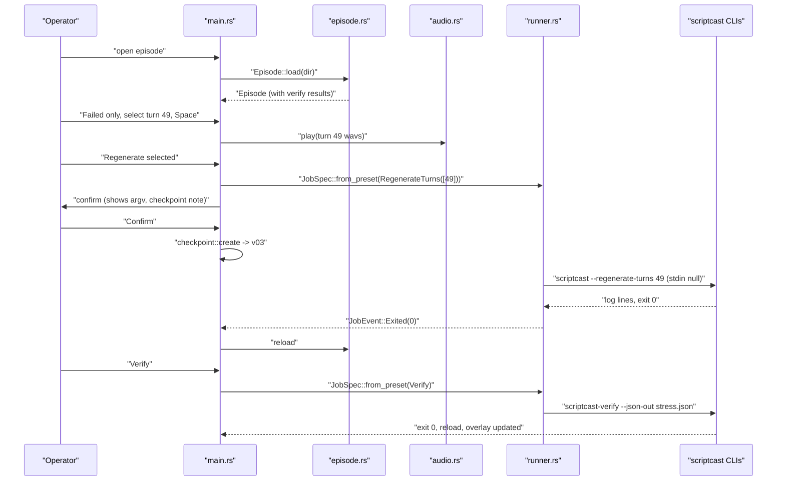

# Tech Plan: Native UI

Parent plan: [plan.md](plan.md)
Every statement below is traceable to a specific file path via the `file:` prefix.

---

## Architectural Approach

Pattern name: **Read-Only File Front-End + Preset Subprocess Runner**

`scriptcast-ui` is a single native binary (eframe/egui, immediate mode) that treats a rendered episode directory as its data source and the existing scriptCast CLIs as its only write path.

- Data comes from files the Python tools already write: `episode_manifest.json` (`file:Dev/Tools/scriptCast/scriptcast/manifest.py:189`), `render_state.json` (`file:Dev/Tools/scriptCast/scriptcast/render_state.py:165`), `TURN_INDEX.csv` (`file:Dev/Tools/scriptCast/scriptcast/tools/turn_index.py:37`) and `stress.json` (`file:Dev/Tools/scriptCast/scriptcast/tools/verify_render.py:303`). The loader mirrors the dataclasses in `file:Dev/Tools/scriptCast/scriptcast/models.py:73-118` with serde, tolerant of unknown fields.
- The whole episode is loaded once into memory (392 turns is tiny) and rebuilt on Reload or after a job. No file watching in v1.
- Playback is rodio on the default output device, one `Player` at a time, segments appended in order.
- Jobs are fixed presets turned into argv from episode metadata, spawned with the project root as cwd and stdin null, streamed line by line over `std::sync::mpsc` from reader threads, which call `egui::Context::request_repaint()`.
- The UI writes exactly two kinds of files in an episode directory: checkpoints under `<episode>/_backups/ui/vNN-*/` (before any job that replaces audio or verification output), and, only through a confirmed Restore, the episode files a checkpoint holds. Everything else is written by the Python CLIs.
- The UI does NOT: write any other file in the episode directory, delete anything, import or embed Python, reimplement parsing of the markdown script, issue `--overwrite`, run more than one job at once, or repaint continuously when idle.

## Key Architectural Decisions

| Decision | Choice | Rationale |
|---|---|---|
| UI toolkit | egui via eframe 0.36 | Chosen by the operator. Native, GPU-rendered, one binary, fast cold start; immediate mode keeps a 4-file app simple |
| Engine boundary | Subprocess the existing CLIs; never link Python | MLX, Whisper and OmniVoice live in Python and in separate venvs (`file:Dev/Tools/scriptCast/scriptcast/project.py:33` `omnivoice_python`); the CLIs are the stable contract already used by every other tool |
| Turn text source | `TURN_INDEX.csv` `first_words`; full text only via `stress.json` expected/heard | Parsing the markdown script would duplicate `file:Dev/Tools/scriptCast/scriptcast/parser.py` and `markup.py` and drift from them; deferred to v2 |
| Render modes exposed | `--detect-changes`, `--precision-insert`, `--regenerate-turns` only | A bare render prompts with `input()` when output exists (`file:Dev/Tools/scriptCast/scriptcast/__main__.py:291`); `--overwrite` deletes the episode (line 121). The three incremental modes never prompt (docstring at lines 264-276) |
| Turn-targeted jobs | Enabled only when the script's SHA-256 equals `render_state.source_hash` | The CLIs take script indices; the UI only knows manifest indices. Equal hashes prove the script has not changed since the render, so the two numberings are identical. Mapping by `turn_id` through the script would need a markdown parser in Rust, which this plan avoids |
| stdin for jobs | Always `Stdio::null()` | Any unexpected prompt fails fast instead of hanging the job forever |
| Executable resolution | Persisted bin-dir setting; empty means PATH | `scriptcast` is not on the default PATH on this machine; installs live in venvs. Auto-detecting venvs is guesswork and is left out |
| Verify join key | `turn_id` | `stress.json` `turn` is the script index, `manifest_turn` the manifest index (`file:Dev/Tools/scriptCast/scriptcast/tools/verify_render.py:196-252`); `turn_id` is stable across both |
| Project root | `$SCRIPTCAST_PROJECT`, else nearest ancestor with `scriptcast.toml` | Same rule as `find_root` (`file:Dev/Tools/scriptCast/scriptcast/project.py:37`), so the UI and the CLIs agree on paths |
| Script path | `render_state.source_file` if absolute, else manifest `source_file` joined to project root | The manifest stores it relative to the render cwd (`file:Dev/Tools/scriptCast/scriptcast/manifest.py:34-44`); render_state stores it absolute in practice |
| Table rendering | Row virtualisation (`ScrollArea::show_rows` or `egui_extras` table) | Only visible rows are laid out, so 400 or 4,000 turns cost the same per frame |
| Concurrency | `std::thread` + `mpsc`, no async runtime | Two reader threads per job is all the concurrency the app needs |
| Mix | Out of v1 | `scriptcast-mix` needs `--config` and `--asr` that cannot be derived from the episode (`file:Dev/Tools/scriptCast/scriptcast/tools/mix.py:97-100`) |
| Persistence | eframe storage (`persistence` feature) | Last episode, recent episodes, bin dir, output device, auto-advance, panel sizes; no config file of our own |
| Visual source of truth | Offline snapshot `file:Dev/Tools/scriptCast/ui/design/` (screens, `tokens.json`, icons, `DESIGN.md`) | The Figma account allows ~20 MCP calls a month; loops must never call Figma. The `.tsx` captures are specs to read, not code to port |
| Styling | One `theme.rs` holding every token; `apply(ctx)` sets egui `Visuals`/`Style`; widgets read colours and sizes from it | Keeps the 30+ colours and fixed sizes in one place and makes screenshot comparison meaningful; no hex literals elsewhere |
| Fonts | OpenDyslexic Regular/Bold + OpenDyslexicMono embedded with `include_bytes!`, one `FONT_SCALE` constant | Operator decision (2026-10-02): a dyslexia-friendly face instead of the design's Inter/IBM Plex Mono. Files come from the operator's DyslexicKeyboard project and `~/Library/Fonts`, so nothing is downloaded. The face is ~45% wider and has a ~1.8 em line box, so layout keeps the design's fixed heights and widths and fits text by ellipsis and, if needed, a global scale |
| Icons | The 21 captured Lucide SVGs via `egui_extras` `svg` + `include_image!` | Exact assets from the design; one binary, no runtime file access |
| Window chrome | Native macOS decorations; title `scriptCast — <episode_id>` | The design's 38 px title bar is OS chrome; drawing fake traffic lights would fight the platform |
| Inspector | Right panel with three modes: Selected turn (376), Verification (436), Job runner (510) | Screens 03–05; one panel keeps the table width predictable and maps to one selection model |
| Verification honesty | Four states: Passed, Failed, Not verified, Missing audio | Real `stress.json` covers a subset of turns (EP03: 18 of 392); the design note forbids manufacturing results |
| Audio device | `rodio::speakers::available_outputs()` + `SpeakersBuilder::device` | The design has an output menu and an Unavailable device state with "Choose output" |
| Checkpoints | Clone the files a job can change into `<episode>/_backups/ui/vNN-<time>-<preset>/` with a `checkpoint.json`, before the job starts; Restore takes a `pre-restore` checkpoint first, then clones back | Operator decision (2026-10-02) to honour the design's "checkpoint is saved first" and "checkpoints are reversible". Clones (APFS copy-on-write via `std::fs::copy`) make a 357 MB `Samples/` checkpoint near-free. A separate `ui/` subfolder keeps clear of the renderer's own `.als` backups in `_backups/` |
| Checkpoint scope | Manifest, render state, `TURN_INDEX.csv`, top-level `.als`, plus: the targeted turns' WAVs (Regenerate, Repair with turns), all of `Samples/` minus `.asd` (Precision insert, Repair without turns), `stress.json` only (Verify) | Covers every file each CLI can change, and nothing it cannot; `.asd` files are excluded because `relayout_episode.py:101` deletes every `*.asd` under the episode |
| Job runner entry point | "Jobs" button at the right of the filter bar + ⌘J | No design screen shows it; operator had no preference (2026-10-02), so the plan default stands and can change after Phase C review |

## Architecture Validation Notes

| Finding | Resolution | Status |
|---|---|---|
| Real manifest (EP03) has 392 turns, 4 speakers, WAV paths relative to episode dir | Loader joins to `dir`; fixture mirrors the shape | ✅ Verified |
| `render_state.json` real schema_version is "2.0" with absolute `source_file`; manifest `source_file` is project-relative | Script-path rule above | ✅ Verified |
| `TURN_INDEX.csv` quotes `first_words` containing commas | Hand-written quoted-field parser; fixture includes a comma | ✅ Resolved (in plan) |
| `stress.json` may cover only a subset of turns (EP03: 18 entries) | `verify: Option<VerifyResult>` per turn; missing means "not checked", not "passed" | ✅ Resolved (in plan) |
| Bare `scriptcast` render prompts interactively | Presets exclude it; stdin null | ✅ Resolved (in plan) |
| `scriptcast` not found on default PATH | Bin-dir setting; spawn error names the path tried | ✅ Resolved (in plan) |
| rodio 0.22 changed API names (`DeviceSinkBuilder`, `Player`) from older `OutputStream`/`Sink` | Plan uses the 0.22 names, read from the registry source | ✅ Verified |
| eframe 0.36 API details (persistence, `run_native` signature) not yet compiled | Implementer confirms at steps 2 and 8 | ⚠️ Verify at step 8 |
| The design promises "a checkpoint is saved first" before audio replacement; no CLI does this | `checkpoint.rs` (plan step 12) creates one before every synthesizing or overwriting job | ✅ Resolved (operator chose checkpoints) |
| Rust `std::fs::copy` on macOS clones via `fclonefileat` on APFS (copy-on-write); not yet measured on this machine | Implementer times a Precision insert checkpoint of EP03-size `Samples/` (copy of a scratch episode) and records it in STATE.md; on a non-APFS volume the copy is a real 357 MB copy | ⚠️ Verify at step 12 |
| egui loads CFF-outline OTF fonts (OpenDyslexic is CFF) | Implementer confirms glyphs render at step 3; if not, convert to TTF once with fontTools and check the converted files in | ⚠️ Verify at step 3 |
| No design screen shows how the Job runner opens with nothing selected | "Jobs" button at the right of the filter bar + ⌘J | ✅ Plan default (operator had no preference) |
| Design shows a determinate job progress bar; the CLIs report no fraction | Indeterminate bar while running | ✅ Resolved (in plan) |
| Design's confirmation shows an "illustrative" command | Show `JobSpec::display()`, the exact argv | ✅ Resolved (in plan) |
| `--regenerate-turns` takes script indices (`file:Dev/Tools/scriptCast/scriptcast/__main__.py:945-950`); manifest indices diverge after any script edit (`file:Dev/Tools/scriptCast/scriptcast/tools/verify_render.py:200-204`) | Turn-targeted presets require `sha256(script) == render_state.source_hash` (`file:Dev/Tools/scriptCast/scriptcast/render_state.py:81-84`) | ✅ Resolved (in plan) |

## Failure Modes

| Failure | Recovery |
|---|---|
| Manifest missing or invalid | `LoadError` panel with path and cause; no partial episode shown |
| Optional file missing or malformed (`render_state`, CSV, stress) | Load continues; the dependent field is empty; a warning line in the header tooltip |
| WAV missing or undecodable | Row-level error; other turns still play |
| No audio output device | Playback disabled with the error; browsing unaffected |
| Executable not found | Job fails at spawn with the full path tried; no state changes |
| Job prompts or waits on stdin | stdin is null, so it reads EOF and exits; the exit code is shown |
| Job hangs | Cancel kills the child; closing the window kills it too |
| Very chatty job | Log pane bounded to 5,000 lines; reader threads never block the UI thread |
| Episode changes on disk during a job | Reload happens once, after exit; a manual Reload is always available |
| Script edited since the last render | `script_in_sync` is false; Regenerate selected and Repair-with-turns disable with "script changed since render: run Detect changes or Precision insert"; whole-episode presets still work |
| Checkpoint cannot be written (disk full, permissions, folder exists) | The job does not start; the error names the path; partial folder has no `checkpoint.json`, so `list` ignores it |
| Restore fails partway | Files already restored stay restored; the `pre-restore` checkpoint taken first holds the prior state and is named in the error |
| Checkpoints accumulate | Size shown at the foot of the Checkpoints list; the app never deletes them; the operator prunes in Finder |
| Text overflows in OpenDyslexic | Fixed-width columns ellipsize; content-sized controls grow; `FONT_SCALE` reduces all text if heights clip |
| Turn indices in stress.json drift from the manifest after a re-render | Join by `turn_id`; stale entries simply match nothing |

## Data Model

### Existing Data Structures (Consumed)

| Source | Fields used |
|---|---|
| `EpisodeManifest` (`file:Dev/Tools/scriptCast/scriptcast/models.py:106-118`) | `episode_id`, `source_file`, `engine`, `sample_rate`, `created_at`, `speakers`, `turns` |
| `SpeakerEntry` (`models.py:96-104`) | `speaker_id`, `display_name`, `engine`, `turn_count` |
| `TurnEntry` (`models.py:85-94`) | `turn_index`, `turn_id`, `speaker_id`, `source_timestamp`, `start_ms`, `end_ms`, `segments` |
| `SegmentEntry` (`models.py:73-83`) | `chunk_index`, `segment_wav`, `duration_ms` |
| `RenderState` (`file:Dev/Tools/scriptCast/scriptcast/render_state.py:42-55`) | `schema_version`, `source_file`, `rendered_at` |
| `TURN_INDEX.csv` (`file:Dev/Tools/scriptCast/scriptcast/tools/turn_index.py`) | `turn_index`, `first_words` |
| `stress.json` (`file:Dev/Tools/scriptCast/scriptcast/tools/verify_render.py:250-262`) | `turn_id`, `score`, `failed`, `expected`, `heard`, `repetition`, `stress[]` |
| `scriptcast.toml` (`file:Dev/Tools/scriptCast/scriptcast/project.py:22-34`) | `voices` |

### New Data Structures (Produced, in memory only)

```rust
pub struct Episode {
    pub dir: PathBuf,
    pub project_root: Option<PathBuf>,
    pub script_path: Option<PathBuf>,
    pub script_in_sync: Option<bool>,   // sha256(script) == render_state.source_hash
    pub voices_path: Option<PathBuf>,
    pub episode_id: String,
    pub engine: String,
    pub sample_rate: u32,
    pub rendered_at: Option<String>,
    pub speakers: Vec<Speaker>,
    pub turns: Vec<Turn>,
    pub warnings: Vec<String>,
}

pub struct Speaker { pub id: String, pub name: String, pub engine: String, pub colour: [u8; 3] }

pub struct Turn {
    pub index: usize,          // manifest turn_index
    pub id: String,            // turn_id
    pub speaker: usize,        // index into speakers
    pub start_ms: u64,
    pub end_ms: u64,
    pub first_words: String,
    pub wavs: Vec<PathBuf>,    // absolute, chunk order
    pub verify: Option<VerifyResult>,
}

pub enum Preset { DetectChanges, PrecisionInsert, RegenerateTurns(Vec<usize>), Verify, Repair(Option<Vec<usize>>) }

pub struct JobSpec { pub program: PathBuf, pub args: Vec<OsString>, pub cwd: PathBuf, pub synthesizes: bool, pub overwrites: Vec<PathBuf> }

pub enum JobEvent { Line(Stream, String), Exited(Option<i32>) }

pub struct Checkpoint {
    pub version: u32,          // vNN, per episode
    pub created_at: String,
    pub preset: String,        // e.g. "regenerate-turns", "verify", "pre-restore"
    pub argv: Vec<String>,
    pub turns: Vec<usize>,
    pub files: Vec<PathBuf>,   // relative to the episode dir
    pub bytes: u64,
    pub dir: PathBuf,          // <episode>/_backups/ui/vNN-<time>-<preset>
}
```

Persisted: eframe UI settings, and checkpoints on disk (`<episode>/_backups/ui/vNN-*/checkpoint.json` plus the cloned files).

## Component Architecture

### Episode loader — `ui/src/episode.rs` (Phase A, extended in C)

Pure functions over the filesystem; no egui types. Owns parsing, path resolution, colours and the stress join. Fully unit-testable against `ui/tests/fixtures/`.

### Theme — `ui/src/theme.rs` (Phase A)

Constants for every value in `ui/design/tokens.json`, `apply(ctx)` for egui `Visuals` and text styles, embedded fonts, the speaker palette, icon sources, and the shared button and field-label helpers. Owns no state.

### Checkpoints — `ui/src/checkpoint.rs` (Phase C)

Plans which files a preset can change, clones them into `_backups/ui/vNN-*/` with a `checkpoint.json`, lists checkpoints, and restores one after taking a `pre-restore` checkpoint. Pure filesystem code, no egui; tested on a temp copy of the fixture.

### App shell — `ui/src/main.rs` (Phases A, B, C)

`eframe::App` implementation. Owns layout (top bar, timeline, table, detail panel, run panel), selection, filters, keyboard handling and persistence. Calls into the other modules; holds no parsing or process logic.

### Audio — `ui/src/audio.rs` (Phase B)

Owns the output device and the single current `Player`. Exposes play, pause, resume, stop, position, finished, which turn is playing, and the list of output devices.

### Runner — `ui/src/runner.rs` (Phase C)

Owns preset-to-argv mapping, process spawn, stream reader threads, cancel and kill-on-drop. Argv construction is a pure function and is tested without spawning Python.

## Component Boundaries

| Component | Owns | Does NOT own |
|---|---|---|
| Episode loader | File parsing, path resolution, project root, colours, verify join | Rendering, audio, processes |
| Theme | Token values, fonts, icons, shared button styling | Layout decisions, state |
| App shell | Layout, selection, filters, keys, persistence, confirmations, inspectors | Parsing, decoding audio, building argv, raw colour values |
| Audio | Device choice, player, segment queueing, pause/position | Which turn is selected, auto-advance policy |
| Runner | Presets, argv, spawn, streaming, cancel | Deciding when to confirm, log display, reload, checkpoints |
| Checkpoints | Which files a preset can change, cloning, `checkpoint.json`, list, restore | Deciding when to checkpoint (the app shell calls it after Confirm), deleting anything |
| Python CLIs | Every write to the episode directory except checkpoints and restores | Anything in the UI |

## Integration Sequence

The review, regenerate and re-verify loop touches every component:


